# DrakesItemShop

A shop you can build. Put goods in a case, on a rack or on a mat and sell them. Buy what customers bring you. Trade face to face. Take the mail. Hang a sign, flip the door, and ring the bell. Or skip the trader NPCs and let a vending machine sell their stock.

Everything is in the **Drake Shop** hammer tab. Prices, locks and who may build are server settings, so a group sees the same shop.

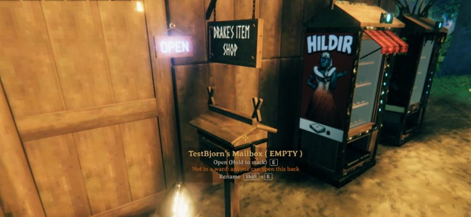

## Sell what you display

A display case, rack or mat has **Open for business** (Shift+E, Shop). Set a price in coins, in items, or both as alternatives: 200 coins, or 10 iron plus 10 coins. A shopper presses **E** on something priced. Coins go to the till. Item payments go in the chest. Unpriced things stay on display and are not for sale.

Glass cases (6 or 3 slots) show the stock lying on jute. You stock them from the door side; the glass door slides while you do. From the glass they are only looked at. Table trays (jute, wolf, lox) sit on a counter. Free-layout mats (jute, wolf, lox, and a small deer rug) are for a stall you arrange yourself: drag, turn, lift and resize on the Layout tab.

Armor racks and weapon racks are finewood with iron hooks. Standing armor racks and weapon racks (6 or 4 slots) take only armor, or only weapons and shields. Wall racks (5 or 3 slots) take both. What is inside hangs the way an item stand would show it, armor upright on its hook. Poses can be tuned per weapon type and per item.

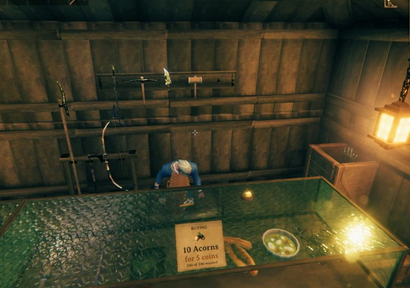

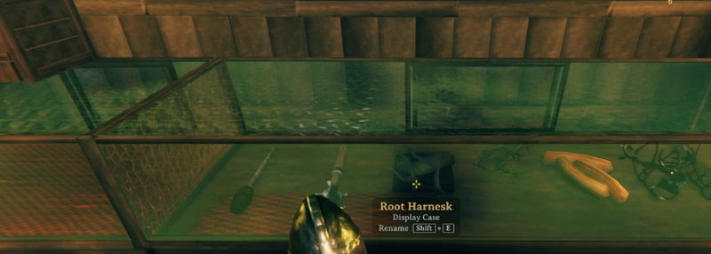

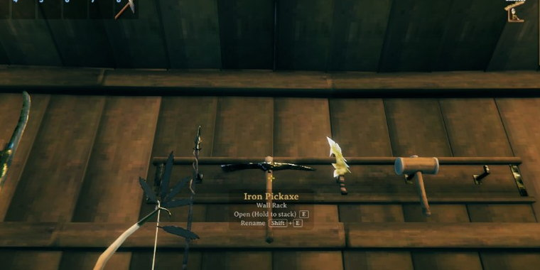

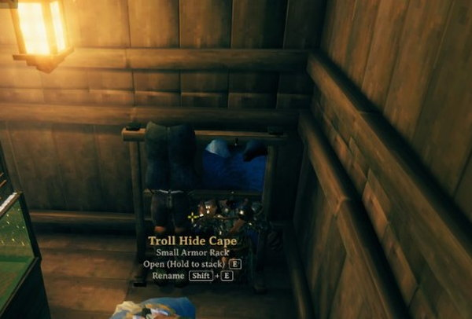

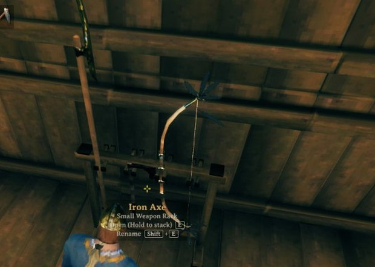

The price window is one deal per stack: what the buyer gets, and one or more ways to pay. Add another option and any one of them is enough. A private catalog on that computer can fill the blanks later. Shoppers never see the catalog.

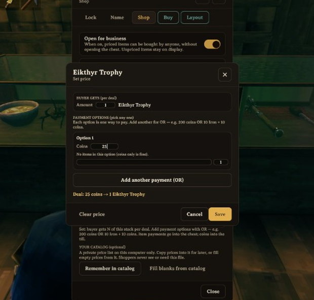

Layout is where a case, rack or mat is arranged. Drag a slot onto another to swap them. The top row is the display. Buy crates sit on the floor around the stand and hold what customers sell you.

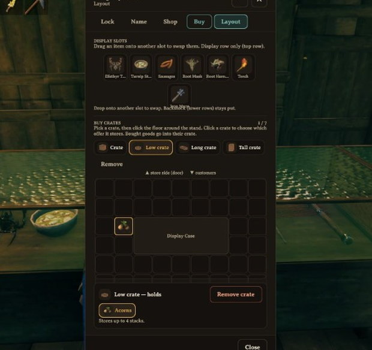

## Buy from your customers

The Buy tab is the other direction. You name an item, how many per deal, what you pay in coins, and a cap. The card on the glass says what you want. When the cap is reached the card stops. Till-tops-up can pay the coins out of sales instead of out of a purse you filled in advance.

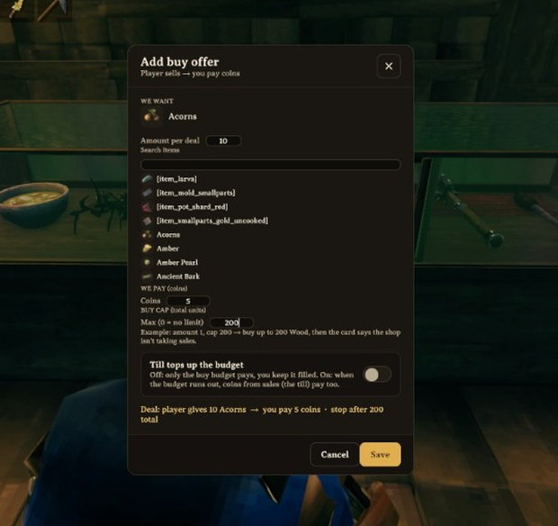

## Trade with a player

Press **Shift+T** near someone (a picker if several people are close). They get a request. If they accept, you each offer items in one window and the swap happens when you both confirm. Walk too far apart and the trade ends. Combat refuses a request.

The shortcut, how long a request waits, the cancel distance and how near someone must be are in `06 Trade` on each player.

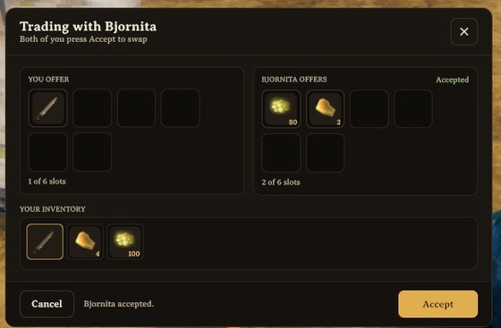

A **Trade Counter** is the same trade across a counter: the shopkeeper behind, the customer in front. **E** opens the register with whoever is standing across. The chest holds stock and takings.

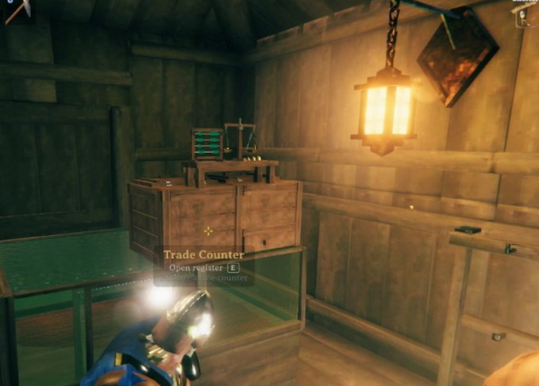

## The door, the sign, the bell

The **Open Sign** flips OPEN and CLOSED with **E**. OPEN glows. CLOSED is a board on the door.

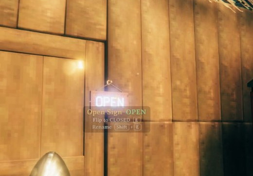

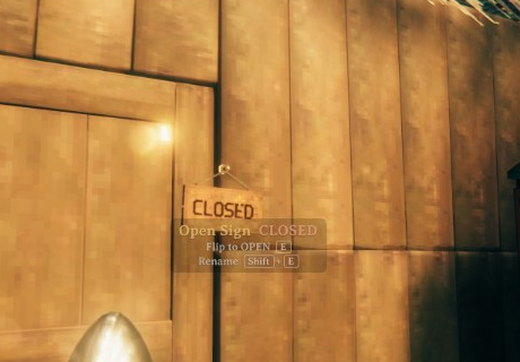

The **Store Sign** is a hanging board you write in a window: bold, italic, colour, fonts, alignment, an outline, line spacing, and the same words on both faces or a blank back. Fit-to-board keeps the letters on the wood.

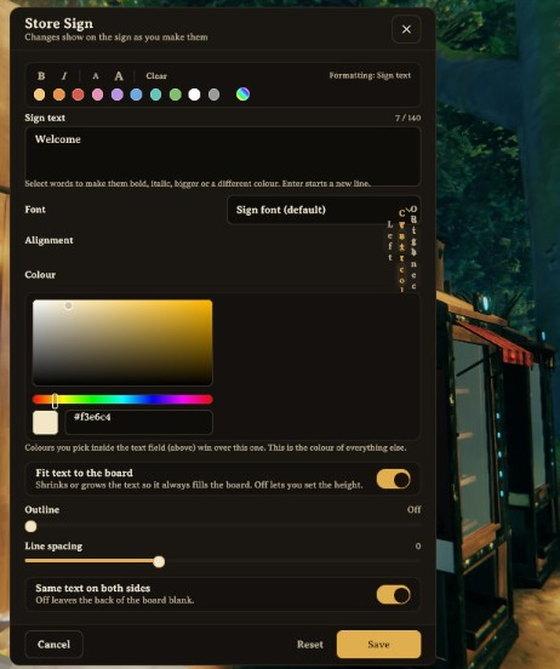

The **Desk Bell** is rung with **E**. The **Door Bell** jingles when a nearby door opens and tells the shopkeeper a customer has arrived. How far the door counts, and whether that message shows, are in `08 Storefront`.

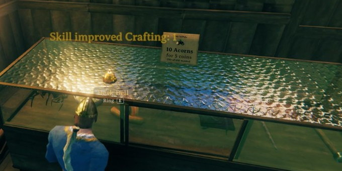

## Mail

A **Mailbox** stands on a post. A **Drop Box** sits on a stall table. Anyone can send up to 3 stacks and a note through the front. It is one way: they cannot take it back out. The back is a 10-slot chest with its own door, opened by whoever the ward or LockSmith allows. The owner sets who may send, which items are taken, and can close the slot. **Tell me when mail arrives** puts a message on your screen when you are nearby.

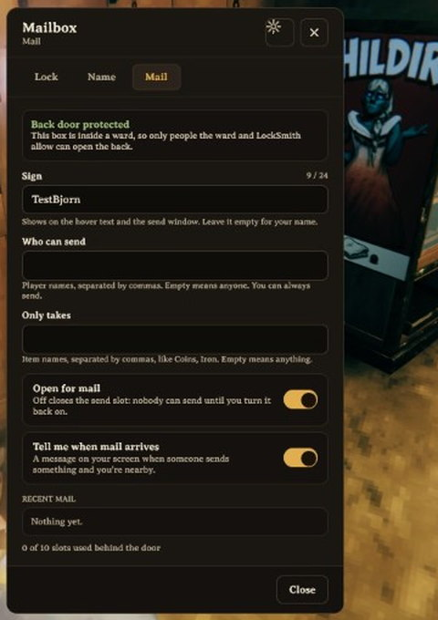

**PO boxes** snap into a post-hall frame (5 by 2). Each box has one door. The assigned owner, and anyone they delegate to, opens it like a chest. Everyone else gets the send window. The builder can act as postmaster. A flag shows mail waiting, or a box that is full. Removing the section removes its boxes, and the mail drops.

With LockSmith, the Lock menu is the same place you lock a chest.

## The apron

Shopkeeper aprons are crafted at the workbench and worn over your clothes. **Open for business** is the bonus: more carry weight, and less stamina for running, jumping, swimming, sneaking, dodging, attacking and blocking. By default it is on under a roof and off in a dungeon, the way a shop is. It can be always on, or any roof including dungeons. The numbers and the rule are server settings in `09 Apron`, and the tooltip shows them.

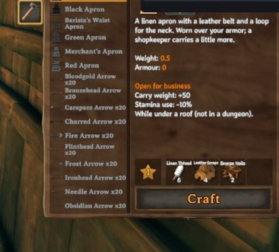

## Vending machines

Haldor's, Hildir's and the Bog Witch's machines sell that trader's real goods, for a server that would rather not have the NPC. Only admins can place them. **E** opens the game's own store. Coins you pay leave the world.

Each machine waits on world keys, the same keys that mark a boss or a biome. By default Haldor wants Eikthyr, the Bog Witch wants the Elder, and Hildir works from the start. Until the keys are set the machine is dark and says it is out of order. Take the key away and it goes dark again. The keys, the out-of-order line, the sold-out card and the bay light are in `10 Vending`, synced to the server.

Behind the glass, 5 by 4 shelves show what you can buy now. Something the world has not unlocked yet stands behind a sold-out card, so the shelf does not spoil it. Buy a thing and that slot's rune flashes, a pusher shoves it off the shelf, it drops down the chute, poofs up to full size and you take it. It is already in your bag. Nothing is dropped on the ground, so a purchase cannot be lost.

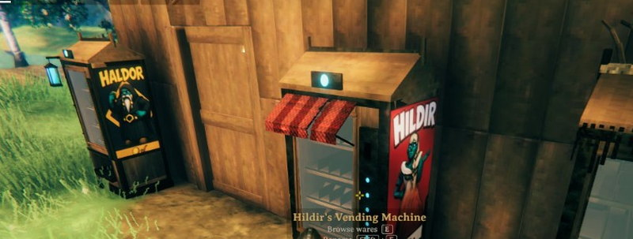

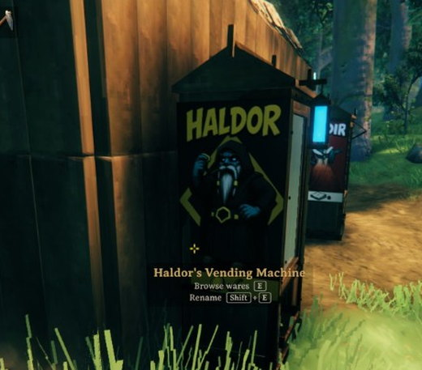

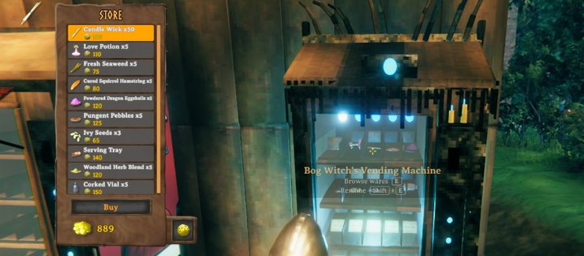

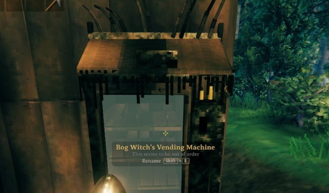

The sides wear a poster of that trader. Haldor's store, once the key is set, is the same window the NPC would have opened.

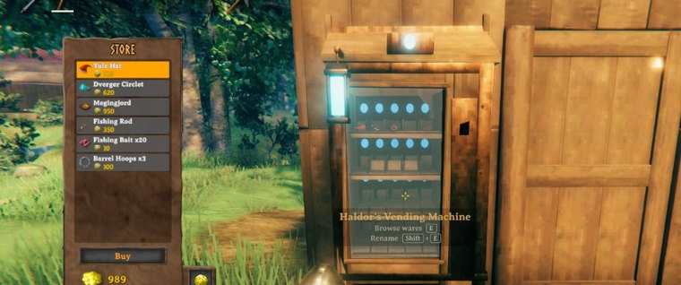

Open crates (a low one and a tall one) are the chests you set on the floor from the Layout tab. Bought goods can land in the crate you pick.

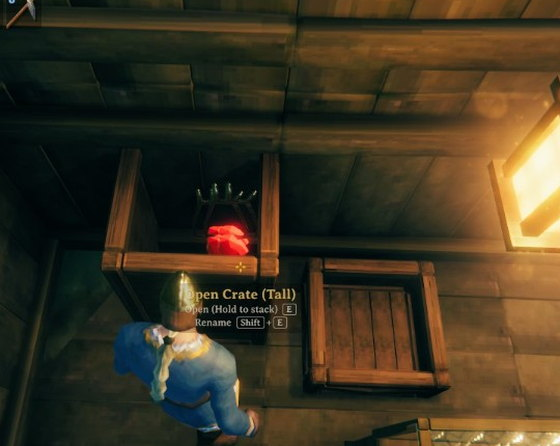

## Server settings

Synced, so the server decides:

| Setting | Default | |
|---------|---------|---|
| `AdminOnlyBuildPieces` | off | Only admins place Drake Shop pieces. Vending machines are admin-only either way. |
| Display case, rack and tray costs | see the config | `Item:amount` pairs, comma separated. |
| `09 Apron` | +50 carry, −10% stamina, under a roof and not a dungeon | Where the apron bonus applies, and how much. |
| `10 Vending` Haldor / Hildir / Bog Witch keys | `defeated_eikthyr` / empty / `defeated_gdking` | World keys before that machine works. Empty means always. |
| `10 Vending` out of order | `This seems to be out of order` | Hover text, and what **E** says, while it is locked. |
| `10 Vending` sold out card | `Sold out` | The card on a slot the world has not unlocked. |
| `10 Vending` bay light | `Night` | `Night`, `Always` or `Off`. A purchase still flashes the slot. |

On each player: `06 Trade` (the shortcut, how long a request lasts, cancel distance, nearby range), `07 Mailbox` (skip the send warning), `08 Storefront` (how near a door must be, and the "a customer has arrived" message).

Mailbox, drop box, PO box and vending costs are fixed in the mod for now. A vending machine is finewood 10, iron 4, crystal 2.

## Dependencies

BepInEx, Jotunn, and **DrakeModsLibs**. **LockSmith** is optional: it adds the Lock menu on mailboxes and chests.

## Build

Open `DrakesItemShop.csproj`, restore NuGet, and build. Paths live in `environment.props` (see `environment.props.example`).

The looks are Drakes Asset Forge packs: `Forge/DisplayCase`, `Forge/ItemRack`, `Forge/Mailbox`, `Forge/Storefront`, `Forge/JuteMat`, `Forge/OpenCrate`, `Forge/VendingMachine`. Each pack's README is how you change that piece.

## Releases

Hexium only. A tag matching `<Version>` in `mod.package.props` (`v0.6.0`, or `v0.6.1-beta.1` for a beta) runs `.github/workflows/release.yml`: it builds, writes the GitHub release from that version's changelog section, and publishes to https://valheim.hexium.gg/mods/DrakeMods/DrakesItemShop.
